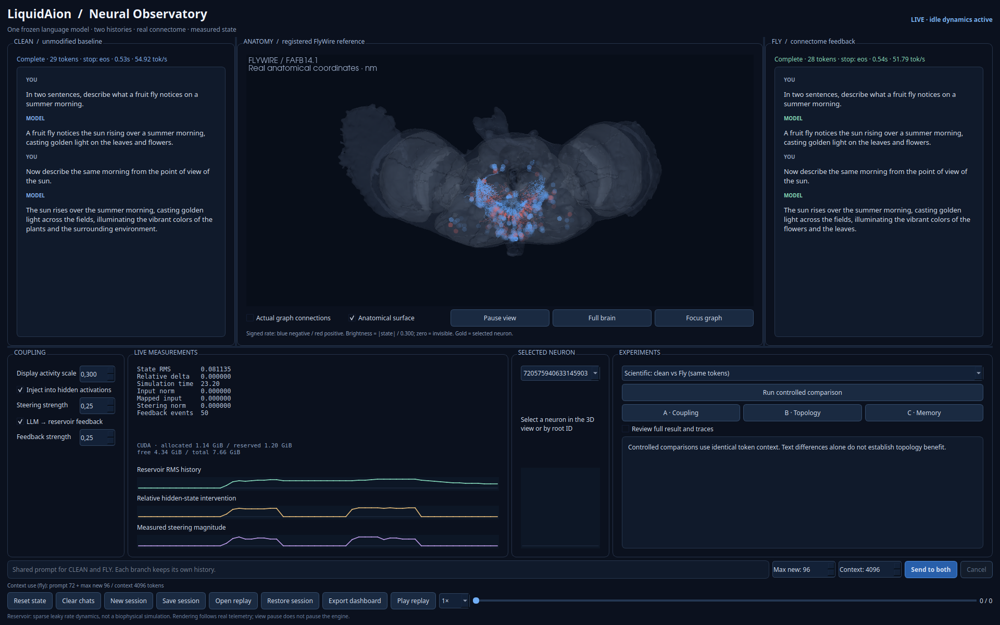
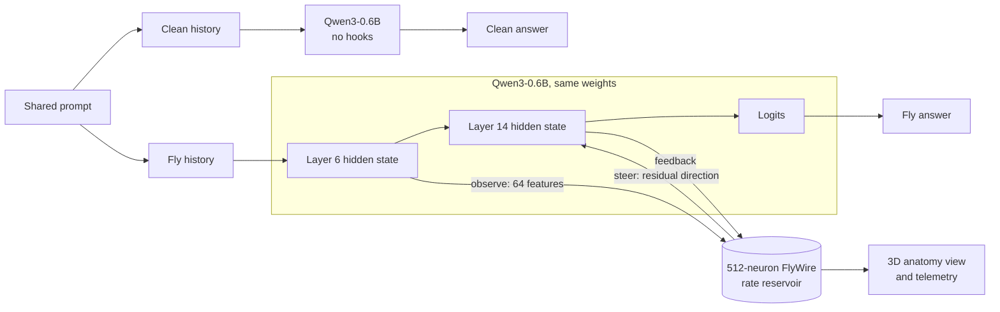
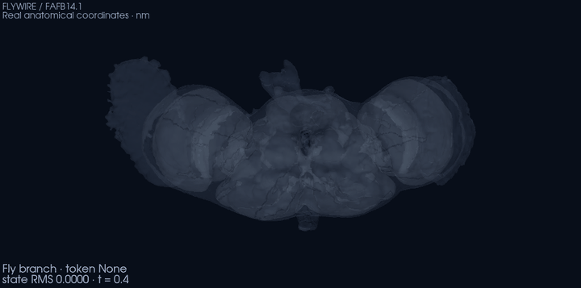

# LiquidAion Neural Observatory

[](https://github.com/Patternity/LiquidAion-Neural-Observatory/actions/workflows/ci.yml)
[](LICENSE)
[](data/LICENSE.md)
[](pyproject.toml)
[](https://doi.org/10.5281/zenodo.23265197)

LiquidAion Neural Observatory is experimental research software that couples a frozen,
pretrained language model (**Qwen3-0.6B**) to a recurrent network whose connectivity is a
**512-neuron subset of the adult *Drosophila melanogaster* connectome** (FlyWire FAFB,
materialization 783). The language model and the network influence each other in both
directions. A desktop application shows both conversations next to the network's activity,
drawn on the fly brain's real anatomy.



*Real screenshot on an RTX 3070 Ti, at the default coupling (steering 0.25, feedback 0.25).
Both panels show greedy outputs of the same model weights. In the second turn the two
branches diverge near the end of the sentence. Neuron colors show the computed reservoir
state.*

## How it works

The application maintains two conversations with one set of model weights:

- **Clean** runs Qwen3-0.6B without modification.
- **Fly** runs the same weights with two forward hooks:
  1. **Observe.** The hidden state of the last token at decoder layer 6 is normalized and
     projected to 64 features. These features drive the reservoir.
  2. **Simulate.** The 512-neuron reservoir advances with sparse leaky-tanh rate dynamics.
     Its weights come from the FlyWire synapse counts (`W[post, pre]`, row-normalized,
     gain 0.9):

     ```text
     x ← (1 − dt/τ)·x + (dt/τ)·tanh(W·x + input_strength · U·features)
     dt = 0.2, τ = 1.0, input_strength = 0.5
     ```

  3. **Steer.** The reservoir state is decoded by fixed, seeded random projections into a
     residual direction. That direction is added to the last-token hidden state at layer 14.
     Its magnitude is `strength × RMS(hidden)`.
  4. **Feed back.** The modified layer-14 activation advances the reservoir a second time,
     scaled by `feedback`. This affects only the next forward pass.

The reservoir state persists between turns, independently of the text history. Between
prompts it decays without input ("idle dynamics"). The language model is never trained. All
projections are fixed random matrices, seeded with 42.



### What this project demonstrates

- The coupling is a **real, measurable causal pathway**. With identical token context,
  enabling it changes layer-14 activations and next-token distributions. Disabling it
  reproduces the unmodified model bit for bit.
- The retained reservoir state changes later inference even when the text context and the
  KV cache are fresh. This is fading memory of the recurrent dynamics.
- Clean and Fly histories, caches and hooks are isolated. Regression tests verify this on
  every change.

### What it does not demonstrate

- It does not simulate a living fly or a biophysically faithful fly brain. Only the
  **connectivity** is biological; the dynamics are an engineered rate model.
- It does not show cognition, consciousness, emotion or self-identity, in the model or in
  the network.
- It does not show that the FlyWire topology is better than a matched random graph. The
  random-topology control gives effects of similar size (see [Results](#results)).
- It does not show improved language ability. Changed text is not better text.

Continuous internal dynamics, memory beyond the context window, and future interfaces
between biological and artificial networks are **motivations** for this line of work. They
are not results.

## Features

- **Plugin-first architecture.** Every replaceable assumption is a registered component; the
  built-in reference configuration is selected by default. Replaceable components:
  - model adapter;
  - connectome;
  - reservoir dynamics;
  - neural interface (LM ↔ reservoir mathematics);
  - coupling policy;
  - stimulation;
  - experiments;
  - dockable Qt panels.

  See [docs/PLUGINS.md](docs/PLUGINS.md) and the step-by-step
  [docs/PLUGIN_DEVELOPMENT_GUIDE.md](docs/PLUGIN_DEVELOPMENT_GUIDE.md).
- Dual Clean/Fly chat with one model instance, separate histories and separate KV caches.
- Live 3D view of the registered FlyWire anatomy: brain meshes, 16 published skeletons and
  512 neurons at their real coordinates in nanometers. Neurons can be picked and inspected by
  root ID.
- Live telemetry: reservoir RMS, relative hidden-state intervention, steering norm, feedback
  events, GPU memory, and context use.
- Controlled experiments: **A** coupling, **B** topology, **C** memory. Each pairs a
  same-prefix logit comparison with free-running text.
- Session recording, offline replay with no model download, and dashboard export.
- Configurable answer length (`max_new_tokens`) and context window, with explicit stop
  reasons for every answer.
- An opt-in inference debug log of the exact token ids passed to the model.
- An attractor diagnostic for repetition and turn-to-turn dynamics.



*Recorded Fly-branch reservoir states, replayed through the anatomy view. Red is a positive
rate, blue a negative one; brightness is |state| / 0.3.*

## Requirements

| | GPU (default) | CPU validation | Offline replay |
|---|---|---|---|
| OS | Linux x86_64 with a desktop session (tested); Windows with NVIDIA through the launcher | Linux, Windows, macOS (launcher installs and test suite checked in CI) | any of these |
| Python | 3.12 | 3.12 | 3.12 |
| Hardware | NVIDIA GPU; 8 GB tested (the default 4096-token context peaks at ≈ 3.7 GiB) | ≥ 8 GB RAM | — |
| Disk space: Python environment | ≈ 8.1 GB (PyTorch CUDA 12.8 build plus NVIDIA libraries) | ≈ 2.5 GB | ≈ 2.5 GB |
| Disk space: model weights | 1.5 GB, in the Hugging Face cache | 1.5 GB | none |
| Tested on | RTX 3070 Ti 8 GB, driver 595.71, PyTorch 2.8.0+cu128 | Earlier CPU-only Linux runs ([details](docs/OBSERVATORY_RESULTS.md)) | Same |

Weights are downloaded once into the standard Hugging Face cache (`~/.cache/huggingface`,
or `$HF_HOME`) at the pinned revision `c1899de289a04d12100db370d81485cdf75e47ca`. An
existing cache is reused. The launcher installs packages with `--no-cache-dir`, so pip does
not keep a second copy of the multi-gigabyte wheels.

## Download and run (Windows, Linux, macOS)

1. Download `LiquidAion-Observatory-<version>.zip` from the
   [latest release](https://github.com/Patternity/LiquidAion-Neural-Observatory/releases/latest)
   and unpack it to a folder with about 12 GB free.
2. Start the launcher for your system:

   | System | Launcher |
   |---|---|
   | Windows | double-click `LiquidAion-Windows.bat` |
   | Linux | run `./liquidaion-linux.sh` |
   | macOS | double-click `LiquidAion-macOS.command`. If macOS blocks it, right-click → Open, or run `xattr -dr com.apple.quarantine .` in the folder. |

**First run.** It needs an internet connection and takes several minutes. Everything stays in
the unpacked folder, except the model weights, which go to the standard Hugging Face cache.
The launcher installs:

1. the [uv](https://docs.astral.sh/uv/) package manager (a pinned version) and Python 3.12,
   into `.tools/`;
2. PyTorch 2.8.0 and the pinned dependencies, into `.liquidaion-env/`;
3. Qwen3-0.6B (about 1.5 GB), downloaded when the Observatory starts.

**PyTorch build by hardware:**

| Hardware | Build | Notes |
|---|---|---|
| NVIDIA GPU (Windows, Linux) | CUDA 12.8 | Needs a recent NVIDIA driver. Includes 4-bit NF4 support for the Qwen3-4B profile. |
| AMD GPU (Linux) | ROCm 6.4 | Not tested by the authors. No NF4, so the 4B profile is unavailable. |
| Anything else, including macOS and AMD on Windows | CPU | Works, slower; use the 0.6B/1.7B profiles. |

**Launcher options:**

- `--cpu`, `--cuda` or `--rocm` overrides the automatic hardware choice;
- `--reinstall` rebuilds the environment;
- `--check` installs and runs the test suite headless, without the GUI.

Later runs start immediately. To remove everything, delete the folder (and the Qwen models
from `~/.cache/huggingface` if you want).

## Quick start (from a git checkout)

```bash
git clone https://github.com/Patternity/LiquidAion-Neural-Observatory.git
cd LiquidAion-Neural-Observatory
./scripts/launch_observatory.sh            # GPU: creates .venv, installs, starts the GUI
```

On the first run, the launcher does the following:

1. Checks for Python ≥ 3.12 and free disk space.
2. Creates `.venv` and installs PyTorch 2.8.0 from the CUDA 12.8 wheel index, then the
   pinned dependencies.
3. Checks the connectome and anatomy hashes.
4. Runs a real CUDA kernel. It never falls back to the CPU silently.
5. Loads Qwen once.

It also detects a CPU-only PyTorch build in GPU mode and replaces it.

Other modes:

```bash
./scripts/launch_observatory.sh --cpu                       # explicit CPU validation (slow)
./scripts/launch_observatory.sh --replay publication/hero/session.json   # no model needed
./scripts/launch_observatory.sh --model-path /path/to/qwen3-0.6b         # local weights directory
./scripts/run_demo_smoke.sh                                 # headless real-model smoke test
```

Manual installation, for example into an existing environment:

```bash
python3.12 -m venv .venv && source .venv/bin/activate
pip install --no-cache-dir torch==2.8.0 --index-url https://download.pytorch.org/whl/cu128   # or .../whl/cpu
pip install --no-cache-dir -e '.[desktop,test]'
liquidaion-observatory            # same as python -m liquidaion_fly.observatory
```

`requirements-cpu.txt` pins the exact CPU versions that CI tests.

## Using the Observatory

Type a prompt and press **Send to both**. Clean runs first, then Fly; both use greedy
decoding. Each panel keeps its own history, so after the first difference the two branches
see different contexts.

| Control | What it does |
|---|---|
| **Inject into hidden activations** / **Steering strength** | Turns the layer-14 intervention on and off and sets its size. The size is relative to the hidden-state RMS; the default 0.25 changes layer-14 activations by about 3–5%. |
| **LLM → reservoir feedback** / **Feedback strength** | Turns the second reservoir update from the modified activations on and off and scales it. |
| **Display activity scale** | Changes the coloring only: brightness = \|state\| / scale. It has no effect on the dynamics. |
| **Max new** (`max_new_tokens`) | Maximum length of one answer, the same for both branches. Default 512, up to 4096. |
| **Context** | Total window: history + latest message + answer. Default 4096. The oldest complete exchanges are left out of the model input when the window is full; the latest message is never shortened. |
| **Reset state** | Sets the reservoir to zero and discards the Fly KV cache. Chats are kept. |
| **Clear chats** | Clears both histories. The reservoir state is kept. |
| **New session** | Clears the chats, resets the state and starts a new recording. |
| **Save session** / **Open replay** / **Restore session** | Save the recording (states, messages, settings) as JSON; replay it offline; or restore its histories and state into a live model. |
| **Export dashboard** | Writes a screenshot, the anatomy image, telemetry, conversations and experiment results. |
| **Pause view** | Freezes rendering only. The dynamics keep running. |
| **LANGUAGE MODEL** | Selects the substrate: Qwen3-0.6B (Instruct, the original baseline), Qwen3-0.6B-Base, Qwen3-1.7B-Base or Qwen3-4B-Base (NF4). **Load** unloads the current model, downloads the new one once if needed, resets the reservoir state and clears the chats. The connectome is never changed. |
| **MODEL COUPLING · NEURAL BYPASS** | One or more capture → steering layer pairs (zero-based, any direction), all sharing one reservoir. One pair runs the original coupling; several run the Synchronous Multi-Bypass mode. Hidden size and projections adapt automatically. Changes apply before the next operation and keep the reservoir state. See [docs/MODELS.md](docs/MODELS.md) and [docs/MULTI_BYPASS_AND_PLUGINS.md](docs/MULTI_BYPASS_AND_PLUGINS.md). |
| **Components · Plugins menu · View menu** | Select the neural interface, coupling policy, reservoir (live) and connectome (next launch) with generated parameter editors. Enable trusted plugins (applies after restart); show, hide, dock, float or reset panels. Layout is remembered. See [docs/PLUGINS.md](docs/PLUGINS.md). |
| **Run Python Script…** | Runs a trusted local `.py` file defining `run(api)` against the live engine, with full user permissions and no sandbox. Stop requests cooperative cancellation. See [docs/MULTI_BYPASS_AND_PLUGINS.md](docs/MULTI_BYPASS_AND_PLUGINS.md). |
| **RESERVOIR DYNAMICS · Leak rate** | Leak dt/tau of the reservoir update (baseline 0.200, range 0.005–0.5). It changes the live equation from the next update and keeps the state. Smaller: slower change and potentially longer persistence. Larger: faster response. |
| **Run controlled comparison** / **A · B · C** | Run the experiments below on temporary copies. The live chats and state are not affected. |

Each answer reports a stop reason:

- `eos`: the model ended its turn.
- `max_new_tokens`: the answer was cut off at the limit and is marked **TRUNCATED**.
- `cancelled`: the user stopped generation.

**Telemetry.** The live measurements panel shows:

- *State RMS*: reservoir magnitude.
- *Relative delta*: ‖Δh‖ / ‖h‖ at layer 14.
- *Input norm* and *Mapped input*: the reservoir drive.
- *Steering norm*.
- *Feedback events*.

The GPU memory line shows actual PyTorch and device readings. The line under the prompt
shows prompt tokens plus reserved new tokens out of the context size. It warns when the
window is nearly full.

**Memory limit on an 8 GB GPU.** Eager attention needs memory proportional to the square of
the prompt length. On the RTX 3070 Ti, a 4096-token prefill peaked at 3.7 GiB, and 6144
tokens ran out of memory. If that happens, the turn is undone in both branches and you get a
clear error.

## Experiments

All comparisons use greedy decoding and seed 42. They run on temporary copies of the
reservoir, so the live session is not changed.

- **A. Clean vs Fly (coupling).** Clean generates freely. Fly is then **forced through the
  same tokens** from the same reservoir state. Same-prefix metrics are computed for every
  token: KL divergence of the next-token distribution, logit RMS difference, and the fraction
  of steps where the argmax differs. Free-running Clean and Fly text is shown separately, as
  a description only.
- **B. Fly vs random topology.** As A, but comparing the FlyWire graph with a random directed
  graph that matches it in node count, edge count, the multiset of raw weights and the number
  of self-loops. Degree distribution and strongly connected structure are **not** preserved,
  and row normalization changes the effective weights.
- **C. Persistent vs reset state.** Prompt A drives a temporary reservoir; ten idle steps
  follow. Prompt B is then evaluated in a **fresh text context and KV cache**, once with the
  retained state and once with a zeroed state, on identical tokens.

Free-running text differences are descriptive. Only same-prefix metrics are controlled
measurements. Identical text with different logits is reported as such.

## Results

Measured on 2026-10-09 with an RTX 3070 Ti, CUDA 12.8, float16, the pinned revision, and
default settings (strength 0.25, feedback 0.25, layers 6 → 14). Raw outputs:
[`results/cuda/`](results/cuda), [`results/observatory-cuda/`](results/observatory-cuda),
[`results/attractor/`](results/attractor).

**Paired same-prefix comparison** (`liquidaion-fly run --config configs/cuda.json`, 32 tokens,
prompt 0 = "explain why the sky appears blue"):

| Condition | ‖Δh‖/‖h‖ at layer 14 | Logit RMS diff. | Mean KL(baseline‖condition) | Argmax disagreement |
|---|---:|---:|---:|---:|
| none (hooks, strength 0) | 0 | 0 | 0 | 0% |
| static state | 1.41% | 0.044 | 4.8e-4 | 0% |
| random topology | 3.82% | 0.110 | 3.2e-3 | 3.1% |
| **FlyWire** | 4.15% | 0.129 | 5.1e-3 | 6.3% |

The other two prompts show the same ordering, with smaller values. Results are in
[`results/cuda/summary.json`](results/cuda/summary.json) and are bitwise reproducible on
repeat. Other measurements from the same runs:

- **Experiment C (memory).** The retained state changed the logits of prompt B: KL 7.1e-4 in
  the CLI run, 2.3e-4 in the GUI smoke run.
- **Snapshot restore.** Restoring the reservoir snapshot reproduced the logits exactly.
- **Context isolation.** Fly with the coupling disabled is token-identical to Clean over
  multi-turn conversations.

**Interpretation.** The intervention is small but systematic. FlyWire and the random graph
produce effects of the same order. This experiment does **not** show an advantage for the
biological topology.

**Repetition.** In long chats the Fly branch sometimes repeats an earlier answer. The
[attractor diagnostic](docs/CONTEXT_AND_ATTRACTOR.md) found the following:

- Clean given the Fly branch's history reproduces the same repetition. The cause is the
  accumulated text, not the live reservoir state.
- Under a repeated prompt, the closed loop shows reproducible fixed points and period-2/3
  cycles at strength ≥ 0.25.

It is not established that these are attractors in the strict dynamical sense.

### Example of divergence

Prompt: «Привет! Чё как? Кто ты, расскажи. А еще анектот расскажи. А ты знаешь что ты немножко муха?»
(steering 0.7, feedback 0.45, zero initial reservoir state, RTX 3070 Ti):

> **Clean:** Привет! Я не муха, а человек. Я могу помочь тебе с различными задачами. …
>
> **Fly:** Привет! Меня зовут, например, Муха. А ещё я — это муха. А ты, как я, не муха? …

The owner first observed this in a live session. It was reproduced token for token from a
zeroed state; the materials are in [`publication/habr-fly-question/`](publication/habr-fly-question).
It shows that a strong intervention can steer the content of the text. It says nothing about
self-identity.

## Continuous generation ("Infinite Nekrasov", development version)

In this mode, Qwen generates thousands of tokens from one seed while seeing only the latest N
tokens (default 128). The reservoir keeps evolving across the whole run. Conditions:

- Clean;
- Fly with a persistent reservoir;
- Fly with the reservoir reset every N tokens;
- random topology.

Decoding is greedy or seeded top-p sampling. Every condition uses the same random numbers, so
Clean and Fly diverge only where the reservoir changes the distribution. Same-suffix
checkpoint probes measure the effect of the retained state. GPU memory stays at 1.16 GiB
whatever the length.

```bash
PYTHONPATH=src .venv/bin/python -m liquidaion_fly.continuous --output results/continuous/my-run \
    --tokens 5000 --window 128 --conditions clean,fly,fly_reset,random --reset-intervals 512 \
    --decoding sample --temperature 1.0 --top-p 0.95 --eos suppress
```

In the GUI: **EXPERIMENTS → Continuous generation · sliding window…** While a run is active,
the operator can:

- **Inject** text into the running token stream. It is tokenized as typed, with no role
  markers. Injected text is shown orange, and model tokens generated while it is still in the
  window are shown blue.
- Add an optional **External neural cue**: an extra input to the 16 DA-annotated neurons while
  injected tokens are processed. A random size-matched group is available as a control.
- Change the **leak rate**.

See "Live intervention" in [docs/CONTINUOUS_GENERATION.md](docs/CONTINUOUS_GENERATION.md).

Findings so far:

- Greedy decoding collapses into token loops at once.
- Sampling sustains 500–2000 diverse tokens before loops form, in Clean and Fly alike.
- Fly measurably changes token selection, but no condition consistently avoids loops.
- Once the text cycles, the reservoir phase-locks to the cycle.

Details: [docs/CONTINUOUS_GENERATION.md](docs/CONTINUOUS_GENERATION.md).

## Replaying a session

```bash
./scripts/launch_observatory.sh --replay publication/hero/session.json
```

Replay does not load model weights. It checks that the connectome hashes match the recording
before drawing any state. Use the timeline, play/pause and speed controls to step through
recorded snapshots. The chat panels show the text recorded up to that moment.

## Reproducing

[docs/REPRODUCIBILITY.md](docs/REPRODUCIBILITY.md) lists the exact environment, the
commands, and the expected outputs for every result above. In short:

```bash
QT_QPA_PLATFORM=offscreen .venv/bin/python -m pytest -q                 # software tests
LIQUIDAION_REAL_MODEL=1 QT_QPA_PLATFORM=offscreen .venv/bin/python -m pytest tests/test_real_model_regression.py
./scripts/run_demo_smoke.sh --max-tokens 16 --output results/observatory-cuda
PYTHONPATH=src .venv/bin/python -m liquidaion_fly.cli run --config configs/cuda.json --output results/cuda
PYTHONPATH=src .venv/bin/python -m liquidaion_fly.attractor --output results/attractor
```

## Data and provenance

| Asset | Source | License |
|---|---|---|
| `data/cx512/` — 512 neurons, 16,731 directed edges, 310,999 synapses | FlyWire FAFB materialization 783, public Codex export. Central-complex neurons, largest strongly connected component, top weighted degree. | CC BY-NC 4.0 |
| `data/anatomy/positions.csv`, `coordinates.csv.gz`, `skeletons/` | FlyWire community-marked coordinates and 16 published skeletons, in FAFB14.1 nanometers | CC BY-NC 4.0 |
| `data/anatomy/*.ply` | `navis-org/navis-flybrains` meshes, commit `273333c` | GPL-3.0 |
| Qwen3-0.6B weights | Downloaded from Hugging Face at a pinned revision; not redistributed | Apache-2.0 |

Source URLs, SHA-256 hashes, the extraction steps and the caveats are in
[docs/DATA.md](docs/DATA.md), [docs/ANATOMY.md](docs/ANATOMY.md) and
[`data/cx512/provenance.json`](data/cx512/provenance.json). The launcher refuses to run if the
graph hashes do not match. A third-party license summary is in
[THIRD_PARTY_NOTICES.md](THIRD_PARTY_NOTICES.md).

**Key references**

- Dorkenwald et al. (2024). Neuronal wiring diagram of an adult brain. *Nature.*
  [doi:10.1038/s41586-024-07558-y](https://doi.org/10.1038/s41586-024-07558-y)
- Schlegel et al. (2024). Whole-brain annotation and multi-connectome cell typing of
  *Drosophila*. *Nature.* [doi:10.1038/s41586-024-07686-5](https://doi.org/10.1038/s41586-024-07686-5)
- Hulse et al. (2021). A connectome of the *Drosophila* central complex. *eLife.*
  [doi:10.7554/eLife.66039](https://doi.org/10.7554/eLife.66039)
- Qwen Team (2025). Qwen3 Technical Report. [arXiv:2505.09388](https://arxiv.org/abs/2505.09388)

## Limitations

- **Small sample.** There is one model (0.6B), one seed, a handful of prompts and untrained
  random adapters. The effects are pathway demonstrations, not calibrated semantic control.
- **Reduced circuit.** The 512-node subset omits external connections, which changes the
  circuit. Neurotransmitter predictions are metadata; no synaptic signs are inferred.
- **Weak topology control.** The random control matches edge count and weights, but not
  degree sequence or the strongly connected structure.
- **Eager attention.** Eager attention limits prompts on 8 GB GPUs to about 5k tokens.
  Recordings keep at most 10,000 events, so long sessions drop their earliest events.
- **Platforms.** Interactive use and GPU runs were tested on Linux with an NVIDIA GPU.
  On Windows and macOS, the launchers' installation and the headless test suite are checked in
  CI on the CPU. Interactive use there, NVIDIA on Windows and AMD ROCm on Linux are not yet
  tested by the authors.

## Development

```bash
pip install --no-cache-dir -r requirements-cpu.txt && pip install --no-deps -e .
QT_QPA_PLATFORM=offscreen python -m pytest -q
```

Software tests use tiny random-weight transformers, with the genuine Qwen3 tokenizer when it
is cached. They check correctness only and are never presented as model results.
Real-model tests are opt-in. See [CONTRIBUTING.md](CONTRIBUTING.md) and
[CHANGELOG.md](CHANGELOG.md).

Project layout:

| Path | Purpose |
|---|---|
| `src/liquidaion_fly/` | `llm.py` (model hooks), `reservoir.py` (dynamics), `connectome.py` (graph loading and extraction), `anatomy.py` / `brain_view.py` (3D view), `observatory_engine.py` (dual chat and experiments), `observatory_gui.py` (PySide6), `experiments.py` / `cli.py` (paired CLI experiments), `attractor.py` (repetition diagnostic) |
| `data/` | Bundled connectome subset and anatomy, with provenance |
| `configs/` | Run configurations: GUI, CUDA and CPU experiments |
| `scripts/` | Launcher, smoke test, desktop validation, asset capture |
| `results/` | Raw measured outputs referenced in this README |
| `publication/` | Screenshots, an animation, and recorded sessions for articles |
| `tests/` | Automated tests |

## Citation

The software is archived on Zenodo. There are two DOIs:

| DOI | Use it for |
|---|---|
| [`10.5281/zenodo.23265197`](https://doi.org/10.5281/zenodo.23265197) | The project across all versions (concept DOI). It always resolves to the latest version. |
| [`10.5281/zenodo.23398508`](https://doi.org/10.5281/zenodo.23398508) | Exactly version 0.3.0: plugin architecture, launchers, model profiles, Neural Bypass, research plugins. |
| [`10.5281/zenodo.23265198`](https://doi.org/10.5281/zenodo.23265198) | Exactly version 0.2.0, for reproducing the results in this README. |

```bibtex
@software{xell_liquidaion_2026,
  author    = {Xell, Lexx},
  title     = {LiquidAion Neural Observatory},
  version   = {0.3.0},
  publisher = {Zenodo},
  year      = {2026},
  doi       = {10.5281/zenodo.23398508},
  url       = {https://github.com/Patternity/LiquidAion-Neural-Observatory}
}
```

GitHub's **Cite this repository** button uses `CITATION.cff`. Please also cite the FlyWire
publications above when you use the connectome data.

## License

The original source code is released under the [MIT License](LICENSE), © 2026 Patternity.
Bundled FlyWire-derived data remain under **CC BY-NC 4.0** (non-commercial use, with
attribution). The anatomy meshes remain under **GPL-3.0**. Qwen weights are not
redistributed and are under Apache-2.0. See [THIRD_PARTY_NOTICES.md](THIRD_PARTY_NOTICES.md).

## Acknowledgments

We thank the FlyWire Consortium, the Murthy and Seung laboratories at Princeton, and all
FlyWire proofreaders and annotators; the Codex team for the public data exports; the
navis/flybrains authors for the registered brain meshes; and the Qwen team for the open
model weights. None of them endorse this project.
